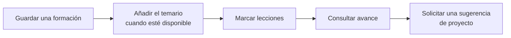
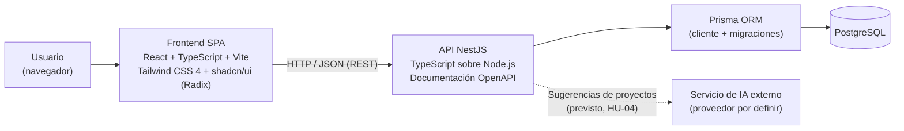
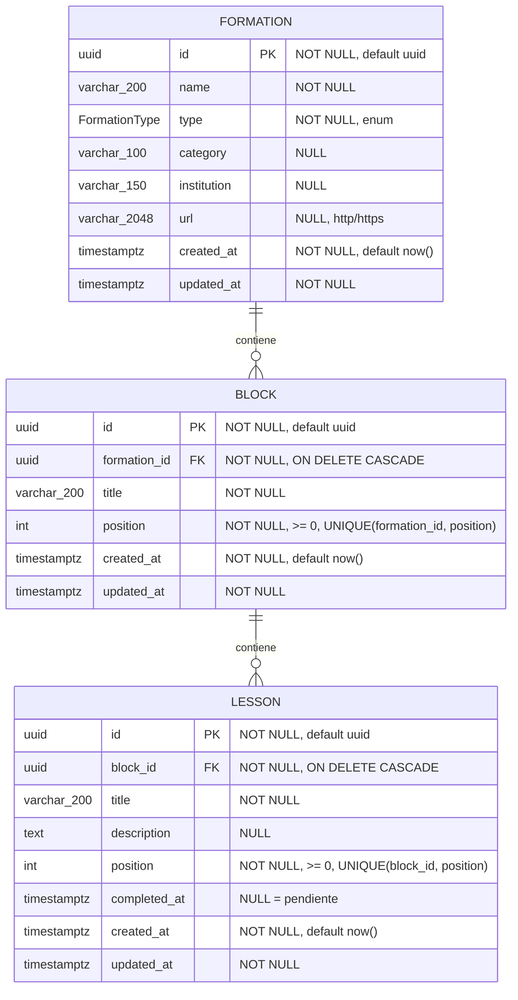

## Índice

0. [Ficha del proyecto](#0-ficha-del-proyecto)
1. [Descripción general del producto](#1-descripción-general-del-producto)
2. [Arquitectura del sistema](#2-arquitectura-del-sistema)
3. [Modelo de datos](#3-modelo-de-datos)
4. [Especificación de la API](#4-especificación-de-la-api)
5. [Historias de usuario](#5-historias-de-usuario)
6. [Tickets de trabajo](#6-tickets-de-trabajo)
7. [Pull requests](#7-pull-requests)

---

## 0. Ficha del proyecto

### **0.1. Tu nombre completo:**

Dimas Gustavo CCahua Cahua

### **0.2. Nombre del proyecto:**

Nivelia

### **0.3. Descripción breve del proyecto:**

Nivelia es una aplicación web para personas que estudian en distintas plataformas o instituciones. Les permite registrar sus formaciones en un solo lugar, organizar el temario en bloques y lecciones, retomar el estudio desde la próxima lección pendiente y recibir sugerencias de proyectos de práctica, generadas con IA, basadas en las lecciones que han marcado como completadas.

**Convención de este documento.** Este README corresponde a la Entrega 1 (documentación técnica). Todavía no hay código, pruebas ejecutadas ni despliegues. Cada decisión se marca así:

- **[Acordado]**: decisión tomada que guía la implementación.
- **[Propuesta]**: recomendación de este borrador, pendiente de validación.
- **[POR COMPLETAR]**: dato o decisión que falta.

### **0.4. URL del proyecto:**

Aún no hay URL de despliegue. [POR COMPLETAR]

### 0.5. URL o archivo comprimido del repositorio

[POR COMPLETAR]

---

## 1. Descripción general del producto

### **1.1. Objetivo:**

**Problema.** Quien estudia por su cuenta suele tener formaciones repartidas entre varias plataformas e instituciones: un programa especializado en LIDR, cursos en Udemy o Udacity, listas de YouTube o una ruta de autoestudio creada con ayuda de una IA. Cada plataforma muestra su propio progreso, algunas no muestran ninguno, y no existe una vista común. Por eso es fácil perder el hilo, no saber por dónde continuar y acumular teoría sin aplicarla.

**Usuario objetivo.** Personas que aprenden de forma autónoma y siguen al mismo tiempo varias formaciones de distinto tipo (cursos, programas especializados, diplomados, maestrías, doctorados o rutas de autoestudio) en plataformas o instituciones diferentes.

**Valor que aporta Nivelia.**

- **Organizar**: reúne todas las formaciones en «Mis formaciones», sin importar dónde se sigan.
- **Retomar**: muestra el avance de cada formación y la próxima lección pendiente.
- **Aplicar**: sugiere proyectos de práctica y explica qué lecciones completadas respaldan cada sugerencia.

**Conceptos del dominio [Acordado].**

| Concepto | Descripción | Ejemplos |
|---|---|---|
| **Formación** | Concepto principal: cualquier recorrido de aprendizaje que sigue el usuario. | AI4Devs, un curso de Udemy, un plan de tres niveles |
| **Tipo de formación** | Clasificación formal. Valores: Curso, Programa especializado, Diplomado, Maestría, Doctorado, Ruta de autoestudio u Otro. | AI4Devs → Programa especializado; curso de Udemy → Curso; plan creado con IA fuera de Nivelia → Ruta de autoestudio |
| **Categoría temática** | Área de estudio. | IA, desarrollo de software, finanzas, exportación |
| **Institución o plataforma** | Quién ofrece la formación o dónde se sigue. | LIDR, Udemy, Udacity, YouTube |
| **Bloque** | Agrupación del temario dentro de una formación. | «Módulo 1», «Nivel 1 — Fundamentos» |
| **Lección** | Unidad que se marca como completada. Los subtítulos internos van en su descripción. | «Introducción a los prompts» |

### **1.2. Características y funcionalidades principales:**

Funcionalidades imprescindibles del MVP **[Acordado]**:

1. **Registrar y consultar formaciones** (HU-01)
   - Nombre y tipo obligatorios.
   - Categoría temática, institución o plataforma y URL opcionales.
   - Se puede guardar una formación sin temario y completarlo después.
   - Si la formación tiene URL, el usuario puede abrir la formación original.
   - En la interfaz: «Mis formaciones» (listado) y «Añadir formación» (alta).

2. **Organizar el temario manualmente** (HU-02)
   - Estructura de dos niveles: Formación → Bloques → Lecciones.
   - El bloque admite cualquier nombre («Módulo 1», «Nivel 1 — Fundamentos»).
   - Los subtítulos internos de una lección van en su descripción.
   - Una maestría o un doctorado se pueden registrar, pero el MVP no modela jerarquías académicas adicionales (semestre → asignatura → unidad).

3. **Marcar lecciones y consultar el avance** (HU-03)
   - Marcar y desmarcar lecciones como completadas.
   - Avance = lecciones completadas / total de lecciones de la formación.
   - Si la formación no tiene lecciones, se muestra «Sin temario».
   - Se muestra la próxima lección pendiente según el orden del temario.

4. **Sugerir proyectos de práctica con IA** (HU-04)
   - Las sugerencias se basan en las lecciones que el usuario marcó como completadas.
   - Cada sugerencia indica qué lecciones completadas la respaldan.
   - Se aclara que completar lecciones no demuestra dominio del tema.
   - Si no hay lecciones completadas, se explica qué necesita registrar el usuario para pedir una sugerencia.

#### Pegar un índice en texto [OPCIONAL]

**Pegar un índice en texto**: el usuario pega el índice de una formación como texto plano, revisa cómo quedó organizado en bloques y lecciones, lo corrige y confirma antes de guardar. No es imprescindible: la edición manual de HU-02 basta para el MVP.

#### Importación desde URL [FUTURO]

Se distinguen dos capacidades:

- **Autocompletar la ficha desde una URL**: rellenar nombre, institución o plataforma y tipo a partir del enlace.
- **Importar el temario completo**: obtener bloques y lecciones de la plataforma de origen.

Enfoque propuesto:

1. Empezar con Udemy como primera plataforma para evaluar la importación desde URL.
2. Preferir la API oficial de la plataforma cuando exista.
3. Considerar la extracción de datos públicos de la página solo si la plataforma lo permite (términos de uso, robots.txt).
4. Mostrar siempre una vista previa editable antes de guardar.
5. Conservar el alta manual cuando falten datos o la URL no sea compatible.

#### Fuera del alcance del MVP [Acordado]

- Importación automática desde URL.
- Acceso a contenido que requiera iniciar sesión en la plataforma de origen.
- Extensión de navegador.
- Sincronización del progreso con las plataformas.
- Generación de cursos completos con IA.
- Registro de costos de las formaciones.

### **1.3. Diseño y experiencia de usuario:**

Aún no hay capturas ni videotutorial porque no existe interfaz implementada. [POR COMPLETAR: capturas o vídeo cuando exista la interfaz]

**Recorrido previsto [Acordado]:**



1. **Guardar una formación.** Desde «Mis formaciones», el usuario pulsa «Añadir formación», escribe el nombre, elige el tipo y, si quiere, añade la categoría temática, la institución o plataforma y la URL. La formación aparece en el listado aunque no tenga temario.
2. **Añadir el temario cuando esté disponible.** En el detalle de la formación crea bloques y, dentro de cada bloque, lecciones con una descripción opcional. Puede ordenar bloques y lecciones.
3. **Marcar lecciones.** Marca como completada cada lección terminada. Si se equivoca, puede desmarcarla.
4. **Consultar avance.** En el listado y en el detalle ve el porcentaje de avance o «Sin temario» y la próxima lección pendiente.
5. **Solicitar una sugerencia de proyecto.** Pide ideas de proyectos de práctica. Cada idea indica qué lecciones completadas la respaldan y recuerda que completar lecciones no demuestra dominio.

**Pantallas previstas para el MVP**

- **Mis formaciones**: listado con nombre, tipo, institución o plataforma, avance y acceso a la URL original. Muestra un estado vacío con la acción «Añadir formación».
- **Añadir formación**: formulario con validación en línea de los campos obligatorios.
- **Detalle de formación**: datos de la ficha, temario editable, avance, próxima lección pendiente y sección de sugerencias.

### **1.4. Instrucciones de instalación:**

[POR COMPLETAR] Se documentarán cuando exista código: requisitos, variables de entorno, instalación de dependencias, arranque del frontend y del backend, migraciones de Prisma y datos de prueba.

---

## 2. Arquitectura del Sistema

### **2.1. Diagrama de arquitectura:**



**Patrón [Propuesta].** Aplicación cliente-servidor con una SPA y una API REST organizada como monolito modular en NestJS. Cada módulo de dominio (`formations`, `syllabus`, `suggestions`) sigue la separación de capas controlador → servicio → acceso a datos con Prisma.

**Justificación.**

- El dominio del MVP es pequeño y cohesionado, así que un único backend modular es suficiente y más simple de desarrollar, probar y desplegar que varios servicios.
- NestJS aporta módulos, inyección de dependencias, validación con DTO y generación de OpenAPI.
- Prisma ofrece tipado de extremo a extremo con TypeScript y migraciones versionadas sobre PostgreSQL.
- La IA se encapsula en un módulo del backend: la clave del proveedor nunca llega al navegador y el proveedor se puede cambiar sin tocar el frontend.

**Sacrificios.**

- Un monolito escala como una sola unidad. Es aceptable para el volumen esperado del MVP.
- Tener frontend y backend separados exige gestionar CORS y dos procesos en desarrollo.
- Depender de un servicio de IA externo añade latencia, costo por uso y un punto de fallo que hay que gestionar (ver HU-04).

### **2.2. Descripción de componentes principales:**

| Componente | Tecnología | Responsabilidad |
|---|---|---|
| Frontend | React + TypeScript + Vite | Aplicación web con un dashboard personal y vistas para listar formaciones, añadir una formación, consultar su temario, seguir el avance y solicitar sugerencias. Consume la API REST y navega entre vistas en el cliente (SPA). |
| Interfaz | Tailwind CSS 4 + shadcn/ui configurado con Radix | Define el diseño compartido de las vistas principales: encabezado y barra lateral, cuya visibilidad depende de la pantalla. Proporciona los componentes para formularios, diálogos, listas e indicadores de avance. |
| API | NestJS + TypeScript sobre Node.js | Backend organizado como monolito modular. Expone los endpoints REST, valida las entradas, aplica las reglas de negocio —como calcular el avance o identificar la próxima lección pendiente— y documenta el contrato con OpenAPI. |
| Acceso a datos | Prisma | Define el esquema y las migraciones, y proporciona al backend un cliente tipado para acceder a PostgreSQL. |
| Base de datos | PostgreSQL | Almacena las formaciones, sus bloques y lecciones, y el estado de avance de cada lección. |
| Servicio de IA | Proveedor y modelo por definir | Genera sugerencias de proyectos de práctica a partir de las lecciones marcadas como completadas y explica en cuáles se basa. Se invoca desde el backend; el navegador solo se comunica con la API de Nivelia. |

**Decisión pendiente:** elegir el proveedor y el modelo de IA al preparar la
implementación de las sugerencias. Esta elección no bloquea el primer flujo
de la Entrega 2: registrar y listar formaciones.

### **2.3. Descripción de alto nivel del proyecto y estructura de ficheros**

**Estructura prevista del monorepo**

Nivelia se organizará en un solo repositorio con dos aplicaciones:
`frontend/` para el dashboard personal en React y `backend/` para la API
en NestJS. El frontend consume la API REST para registrar y consultar
formaciones.

```text
AI4Devs-finalproject/
├── frontend/                         # Dashboard personal en React + Vite
│   ├── src/
│   │   ├── app/
│   │   │   ├── router.tsx            # Rutas del frontend
│   │   │   └── layouts/
│   │   │       └── dashboard-layout.tsx  # Header, sidebar y vista activa
│   │   ├── components/ui/            # Componentes compartidos de shadcn/ui
│   │   ├── features/
│   │   │   └── formations/           # Formulario, listado y detalle
│   │   ├── lib/                      # Cliente HTTP y utilidades compartidas
│   │   └── main.tsx                  # Arranque de React
│   └── tests/e2e/                    # Pruebas del flujo desde el navegador
├── backend/                          # API NestJS: monolito modular
│   ├── src/
│   │   ├── formations/               # HU-01: registrar y listar formaciones
│   │   │   ├── dto/
│   │   │   │   └── create-formation.dto.ts
│   │   │   ├── formations.controller.ts
│   │   │   ├── formations.service.ts
│   │   │   └── formations.module.ts
│   │   ├── syllabus/                 # HU-02 y HU-03: temario y avance
│   │   ├── suggestions/              # HU-04: sugerencias con IA
│   │   ├── prisma/                   # Módulo y servicio de acceso a datos
│   │   ├── app.module.ts             # Integra los módulos de NestJS
│   │   └── main.ts                   # Arranque, validación y OpenAPI
│   ├── prisma/
│   │   ├── schema.prisma
│   │   └── migrations/
│   └── test/                         # Pruebas de integración de la API
├── prompts.md
└── readme.md
```

- `frontend/` agrupa las vistas y la lógica de cada funcionalidad en
  `features/`. Las rutas y el layout del dashboard viven en `app/`;
  los componentes compartidos y el cliente HTTP tienen su propio espacio.
- `backend/src/` se organiza por módulos de NestJS. El módulo `formations/`
  agrupa el controlador HTTP, el servicio y los DTO de entrada. El módulo
  `prisma/` proporciona el servicio compartido de acceso a datos.
- `backend/prisma/` contiene el esquema de Prisma y el historial de
  migraciones de PostgreSQL.

El árbol representa la estructura prevista del MVP. Para la Entrega 2,
se implementará primero HU-01: registrar y listar formaciones. La demo
local abrirá directamente «Mis formaciones», sin inicio de sesión.
### **2.4. Infraestructura y despliegue**

Nivelia aún no está desplegado. El primer flujo de la Entrega 2 se
ejecutará en local.

- **Desarrollo local**: PostgreSQL se ejecutará en un contenedor con
  Docker Compose. El frontend y el backend usarán sus servidores de
  desarrollo.
- **Configuración**: `.env.example` documentará las variables necesarias,
  como `DATABASE_URL` y el origen del frontend, con valores de ejemplo
  que no contengan secretos. La clave del servicio de IA se configurará
  en el backend cuando se implemente HU-04.
- **Despliegue**: el hosting del frontend, el backend y PostgreSQL
  se definirá cuando se planifique el primer despliegue.
- **Integración y despliegue continuos**: se prevé ejecutar lint y pruebas
  en cada pull request. Para el despliegue, se prevé aplicar las
  migraciones pendientes con `prisma migrate deploy` antes de iniciar
  la nueva versión del backend. La herramienta de CI/CD queda por definir.

### **2.5. Seguridad**

Las siguientes medidas forman parte del diseño previsto y aún no se han
implementado:

- **Validación de entradas**: el backend usará DTO y un `ValidationPipe`
  global con `whitelist` y `forbidNonWhitelisted`. Se validarán las
  longitudes máximas y solo se admitirán enlaces `http` o `https`.
- **Acceso a datos**: se usará el cliente de Prisma para las consultas.
  Si se necesita SQL directo, se usarán parámetros en lugar de concatenar
  datos recibidos del usuario.
- **Secretos**: las credenciales de la base de datos y la clave del
  proveedor de IA se configurarán en el entorno del backend, fuera del
  repositorio.
- **CORS**: la API permitirá solicitudes del navegador desde el origen
  del frontend configurado. CORS no sustituye al control de acceso.
- **Enlaces externos**: si un enlace a una formación se abre en una
  pestaña nueva, se usará `rel="noopener noreferrer"`.
- **Uso de IA (HU-04)**: se limitarán las peticiones al endpoint de
  sugerencias para controlar el abuso y los costos. Solo se enviarán al
  proveedor los títulos y las descripciones de las lecciones que sean
  necesarios para generar la sugerencia.
- **Autenticación y multiusuario**: la demo de la Entrega 2 será local,
  de un solo usuario y sin inicio de sesión. Las cuentas y el aislamiento
  de datos se evaluarán antes de habilitar el uso compartido.

### **2.6. Tests**

Plan de pruebas del MVP. Aún no se ha ejecutado ninguna prueba.

- **Unitarias**:
  - **Backend (Jest)**: comprobar el cálculo del avance y de la próxima
    lección pendiente, incluido el caso de una formación sin temario.
  - **Frontend (Vitest)**: comprobar que el formulario «Añadir formación»
    indique qué campos obligatorios faltan antes de enviar la solicitud.
- **Integración (Jest + Supertest con PostgreSQL de prueba)**:
  - Verificar que `POST /formations` devuelva `201 Created` con datos
    válidos y que `GET /formations` incluya la misma formación creada.
  - Verificar que `POST /formations` devuelva `400 Bad Request` cuando
    falte un campo obligatorio, el tipo no esté permitido o la URL sea
    inválida.
- **Extremo a extremo (Playwright)**: crear una formación desde
  «Añadir formación», recargar la página y comprobar que sigue
  apareciendo en «Mis formaciones».

---

## 3. Modelo de Datos

### **3.1. Diagrama del modelo de datos:**



Evolución prevista para el uso multiusuario: separar el catálogo de formaciones del seguimiento personal. Los usuarios podrán reutilizar fichas existentes y guardar su avance por lección. Las coincidencias por nombre se mostrarán como sugerencias; la reutilización automática requerirá un identificador fiable.

### **3.2. Descripción de entidades principales:**

**Convenciones [Propuesta].** Los identificadores del código y de la API están en inglés. En Prisma los campos de Prisma usan camelCase (createdAt) y se mapean a columnas en snake_case (created_at) (`Formation.createdAt`) y se mapean a tablas y columnas en snake_case (`formations.created_at`) con `@@map` y `@map`. Las claves primarias son UUID.

#### Formation (tabla `formations`)

Representa una formación del usuario. Solo `name` y `type` son obligatorios **[Acordado]**.

| Campo (Prisma / columna) | Tipo | Restricciones | Descripción | Etiqueta en la interfaz |
|---|---|---|---|---|
| `id` / `id` | UUID | PK, NOT NULL | Identificador. | — |
| `name` / `name` | VARCHAR(200) | NOT NULL, 1–200 caracteres sin espacios iniciales o finales | Nombre de la formación. | Nombre |
| `type` / `type` | Enum `FormationType` | NOT NULL | Tipo de formación. | Tipo de formación |
| `category` / `category` | VARCHAR(100) | NULL | Área de estudio, texto libre. | Categoría temática |
| `institution` / `institution` | VARCHAR(150) | NULL | Quién ofrece la formación o dónde se sigue, texto libre. | Institución o plataforma |
| `url` / `url` | VARCHAR(2048) | NULL; si existe, URL absoluta `http` o `https` | Enlace a la formación original. | URL |
| `createdAt` / `created_at` | TIMESTAMPTZ | NOT NULL, `now()` | Fecha de alta. Ordena el listado. | — |
| `updatedAt` / `updated_at` | TIMESTAMPTZ | NOT NULL, `@updatedAt` | Última modificación. | — |

Relación: una formación tiene de 0 a N bloques (1:N). Si no tiene bloques ni lecciones, la formación es válida y se muestra «Sin temario».

**Enum `FormationType`:**

| Valor técnico | Etiqueta en la interfaz |
|---|---|
| `COURSE` | Curso |
| `SPECIALIZED_PROGRAM` | Programa especializado |
| `DIPLOMA` | Diplomado |
| `MASTERS` | Maestría |
| `DOCTORATE` | Doctorado |
| `SELF_STUDY_PATH` | Ruta de autoestudio |
| `OTHER` | Otro |

> La categoría temática y la institución o plataforma son texto libre en el MVP **[Propuesta]**. Convertirlas en catálogos o en entidades propias queda para una evolución futura.

#### Block (tabla `blocks`)

Agrupa las lecciones de una formación (por ejemplo, «Módulo 1» o «Nivel 1 — Fundamentos»).

| Campo (Prisma / columna) | Tipo | Restricciones | Descripción |
|---|---|---|---|
| `id` / `id` | UUID | PK, NOT NULL | Identificador. |
| `formationId` / `formation_id` | UUID | FK → `formations.id`, NOT NULL, `ON DELETE CASCADE` | Formación a la que pertenece. |
| `title` / `title` | VARCHAR(200) | NOT NULL, 1–200 caracteres | Nombre del bloque. |
| `position` / `position` | INTEGER | NOT NULL, ≥ 0, UNIQUE (`formation_id`, `position`) | Orden dentro de la formación. |
| `createdAt` / `created_at` | TIMESTAMPTZ | NOT NULL | Fecha de alta. |
| `updatedAt` / `updated_at` | TIMESTAMPTZ | NOT NULL | Última modificación. |

Relaciones: N:1 con Formation; 1:N con Lesson.

#### Lesson (tabla `lessons`)

Unidad mínima del temario. Es lo que se marca como completado.

| Campo (Prisma / columna) | Tipo | Restricciones | Descripción |
|---|---|---|---|
| `id` / `id` | UUID | PK, NOT NULL | Identificador. |
| `blockId` / `block_id` | UUID | FK → `blocks.id`, NOT NULL, `ON DELETE CASCADE` | Bloque al que pertenece. |
| `title` / `title` | VARCHAR(200) | NOT NULL, 1–200 caracteres | Título de la lección. |
| `description` / `description` | TEXT | NULL | Detalle y subtítulos internos de la lección. |
| `position` / `position` | INTEGER | NOT NULL, ≥ 0, UNIQUE (`block_id`, `position`) | Orden dentro del bloque. |
| `completedAt` / `completed_at` | TIMESTAMPTZ | NULL | Fecha en que se marcó como completada; `NULL` = pendiente. |
| `createdAt` / `created_at` | TIMESTAMPTZ | NOT NULL | Fecha de alta. |
| `updatedAt` / `updated_at` | TIMESTAMPTZ | NOT NULL | Última modificación. |

Relación: N:1 con Block. La relación con Formation es indirecta, a través del bloque.

#### Orden del temario

- El orden se guarda explícitamente en `position`, sin depender de la fecha de creación.
- Los bloques se ordenan por `blocks.position` dentro de su formación y las lecciones por `lessons.position` dentro de su bloque.
- Para listar el temario completo de una formación en una sola consulta, se usa `ORDER BY blocks.position, lessons.position`.
- Las restricciones `UNIQUE (formation_id, position)` en `blocks` y `UNIQUE (block_id, position)` en `lessons` evitan posiciones duplicadas dentro del mismo listado. Se permiten saltos en la numeración, por ejemplo `10, 20, 30`.

#### Lecciones completadas, avance y próxima lección

- Una lección se considera completada si `completed_at` contiene una fecha   y hora. Al desmarcarla, el campo vuelve a `NULL`. En el MVP de un solo usuario, el estado de avance se guarda en la propia lección.
- El avance de una formación se calcula como `(lecciones completadas / total de lecciones) × 100` y se redondea hacia
  abajo a un porcentaje entero. Si no hay lecciones, se muestra «Sin temario».
- La próxima lección es la primera pendiente según el orden de los bloques y las lecciones. Si no hay lecciones pendientes, no se muestra una próxima.
- El porcentaje se calcula al consultar la formación; no se guarda en una columna independiente.
- Las sugerencias de IA (HU-04) se muestran al solicitarlas. El historial de sugerencias queda fuera del MVP.

---

## 4. Especificación de la API

**[Acordado]** API REST documentada con OpenAPI. Los dos endpoints siguientes son **el contrato del primer flujo de la Entrega 2** (HU-01): crear una formación y listarla. Los endpoints de temario (HU-02), avance (HU-03) y sugerencias (HU-04) se especificarán más adelante. [POR COMPLETAR]

**Correspondencia de nombres.** Los campos JSON de la API coinciden con los campos del modelo Prisma `Formation` (sección 3.2): `id`, `name`, `type`, `category`, `institution`, `url`, `createdAt`, `updatedAt`. Solo cambia la columna física en snake_case.

**Reglas de validación [Propuesta: límites concretos]:**

| Campo | Obligatorio | Regla |
|---|---|---|
| `name` | Sí | String; se eliminan los espacios iniciales y finales; 1–200 caracteres. |
| `type` | Sí | Uno de los valores de `FormationType`. |
| `category` | No | String de hasta 100 caracteres o `null`. Una cadena vacía se guarda como `null`. |
| `institution` | No | String de hasta 150 caracteres o `null`. Una cadena vacía se guarda como `null`. |
| `url` | No | URL absoluta `http` o `https` de hasta 2048 caracteres, o `null`. Una cadena vacía se guarda como `null`. |
| Otros campos | — | Se rechazan con `400`. `id`, `createdAt` y `updatedAt` los asigna el servidor. |

```yaml
openapi: 3.0.3
info:
  title: Nivelia API
  version: 0.1.0
  description: >
    Contrato del primer flujo de la Entrega 2 (HU-01): crear y listar formaciones.
paths:
  /formations:
    post:
      tags: [Formations]
      operationId: createFormation
      summary: Crear una formación
      description: >
        Registra una formación. Solo `name` y `type` son obligatorios.
        La formación se crea sin temario.
      requestBody:
        required: true
        content:
          application/json:
            schema:
              $ref: '#/components/schemas/CreateFormationRequest'
            examples:
              minima:
                summary: Solo campos obligatorios
                value:
                  name: AI4Devs
                  type: SPECIALIZED_PROGRAM
              completa:
                summary: Con campos opcionales
                value:
                  name: AI4Devs
                  type: SPECIALIZED_PROGRAM
                  category: IA
                  institution: LIDR
                  url: https://example.com/ai4devs
      responses:
        '201':
          description: Formación creada.
          content:
            application/json:
              schema:
                $ref: '#/components/schemas/Formation'
              example:
                id: 3f1c2b9e-6a4d-4c8e-9b1a-2d5e7f8a9b0c
                name: AI4Devs
                type: SPECIALIZED_PROGRAM
                category: IA
                institution: LIDR
                url: https://example.com/ai4devs
                createdAt: '2026-11-16T10:00:00.000Z'
                updatedAt: '2026-11-16T10:00:00.000Z'
        '400':
          description: >
            Datos inválidos: falta `name` o `type`, `type` no está en el enum,
            se supera una longitud máxima, `url` no es http/https o se envía un campo no permitido.
          content:
            application/json:
              schema:
                $ref: '#/components/schemas/ErrorResponse'
              example:
                statusCode: 400
                message:
                  - name should not be empty
                  - type must be one of the following values: COURSE, SPECIALIZED_PROGRAM, DIPLOMA, MASTERS, DOCTORATE, SELF_STUDY_PATH, OTHER
                error: Bad Request
        '500':
          $ref: '#/components/responses/InternalError'
    get:
      tags: [Formations]
      operationId: listFormations
      summary: Listar formaciones («Mis formaciones»)
      description: >
        Devuelve todas las formaciones registradas, ordenadas por `createdAt`
        descendente (las más recientes primero). Sin paginación en el MVP.
      responses:
        '200':
          description: Listado de formaciones (puede estar vacío).
          content:
            application/json:
              schema:
                type: array
                items:
                  $ref: '#/components/schemas/Formation'
              example:
                - id: 3f1c2b9e-6a4d-4c8e-9b1a-2d5e7f8a9b0c
                  name: AI4Devs
                  type: SPECIALIZED_PROGRAM
                  category: IA
                  institution: LIDR
                  url: null
                  createdAt: '2026-11-16T10:00:00.000Z'
                  updatedAt: '2026-11-16T10:00:00.000Z'
        '500':
          $ref: '#/components/responses/InternalError'
components:
  schemas:
    FormationType:
      type: string
      description: >
        COURSE = Curso; SPECIALIZED_PROGRAM = Programa especializado;
        DIPLOMA = Diplomado; MASTERS = Maestría; DOCTORATE = Doctorado;
        SELF_STUDY_PATH = Ruta de autoestudio; OTHER = Otro.
      enum: [COURSE, SPECIALIZED_PROGRAM, DIPLOMA, MASTERS, DOCTORATE, SELF_STUDY_PATH, OTHER]
    CreateFormationRequest:
      type: object
      additionalProperties: false
      required: [name, type]
      properties:
        name:
          type: string
          minLength: 1
          maxLength: 200
          description: Nombre de la formación (se recortan los espacios).
        type:
          $ref: '#/components/schemas/FormationType'
        category:
          type: string
          nullable: true
          maxLength: 100
          description: Categoría temática.
        institution:
          type: string
          nullable: true
          maxLength: 150
          description: Institución o plataforma.
        url:
          type: string
          format: uri
          nullable: true
          maxLength: 2048
          pattern: '^https?://'
          description: URL de la formación original.
    Formation:
      type: object
      required: [id, name, type, category, institution, url, createdAt, updatedAt]
      properties:
        id:
          type: string
          format: uuid
        name:
          type: string
        type:
          $ref: '#/components/schemas/FormationType'
        category:
          type: string
          nullable: true
        institution:
          type: string
          nullable: true
        url:
          type: string
          format: uri
          nullable: true
        createdAt:
          type: string
          format: date-time
        updatedAt:
          type: string
          format: date-time
    ErrorResponse:
      type: object
      required: [statusCode, message]
      properties:
        statusCode:
          type: integer
        message:
          oneOf:
            - type: string
            - type: array
              items:
                type: string
        error:
          type: string
  responses:
    InternalError:
      description: Error inesperado del servidor.
      content:
        application/json:
          schema:
            $ref: '#/components/schemas/ErrorResponse'
          example:
            statusCode: 500
            message: Internal server error
```

> La URL de los ejemplos (`https://example.com/...`) es ilustrativa. El servidor base y el puerto se definirán con la instalación. [POR COMPLETAR]

---

## 5. Historias de Usuario

**Historia de Usuario 1 — HU-01: Registrar y consultar formaciones**

> **Como** persona que estudia en varias plataformas,
> **quiero** registrar mis formaciones y verlas en un solo listado,
> **para** saber en todo momento qué estoy estudiando y dónde.

Criterios de aceptación:

1. **Dado que** estoy en «Mis formaciones», **cuando** pulso «Añadir formación», **entonces** veo un formulario con Nombre y Tipo de formación como obligatorios y Categoría temática, Institución o plataforma y URL como opcionales.
2. **Dado que** completo solo el nombre y el tipo, **cuando** guardo, **entonces** la formación se crea y aparece en «Mis formaciones».
3. **Dado que** guardé una formación, **cuando** recargo la página, **entonces** la formación sigue apareciendo en el listado.
4. **Dado que** dejo vacío el nombre o el tipo, **cuando** intento guardar, **entonces** no se crea la formación y se indica qué campo falta.
5. **Dado que** escribo una URL que no empieza por `http://` o `https://`, **cuando** intento guardar, **entonces** se muestra un error de formato y no se crea la formación.
6. El selector de tipo ofrece exactamente: Curso, Programa especializado, Diplomado, Maestría, Doctorado, Ruta de autoestudio y Otro.
7. **Dado que** una formación tiene URL, **cuando** pulso su enlace, **entonces** la formación original se abre en una pestaña nueva. Si no tiene URL, no se muestra enlace.
8. **Dado que** una formación no tiene temario, **cuando** la veo en el listado, **entonces** muestra «Sin temario».
9. **Dado que** no tengo formaciones, **cuando** abro «Mis formaciones», **entonces** veo un estado vacío con la acción «Añadir formación».

**Historia de Usuario 2 — HU-02: Organizar el temario**

> **Como** persona que sigue una formación,
> **quiero** organizar su temario en bloques y lecciones,
> **para** tener una estructura que pueda seguir aunque la plataforma original no la muestre o la haya creado por mi cuenta.

Criterios de aceptación:

1. **Dado que** tengo una formación sin temario, **cuando** abro su detalle, **entonces** puedo añadir un bloque con un título libre (por ejemplo, «Módulo 1» o «Nivel 1 — Fundamentos»).
2. **Dado que** existe un bloque, **cuando** añado una lección con título y, opcionalmente, una descripción, **entonces** la lección aparece dentro de ese bloque al final del orden actual.
3. Puedo editar el título de un bloque y el título y la descripción de una lección.
4. Puedo cambiar el orden de los bloques dentro de la formación y de las lecciones dentro de su bloque, y el nuevo orden se mantiene al recargar la página.
5. **Dado que** elimino un bloque, **cuando** confirmo la acción, **entonces** se eliminan también sus lecciones.
6. Un bloque o una lección no se pueden guardar con el título vacío.
7. El temario solo admite dos niveles (bloque → lección); los subtítulos internos se escriben en la descripción de la lección.

**Historia de Usuario 3 — HU-03: Marcar lecciones y consultar el avance**

> **Como** persona que retoma una formación,
> **quiero** marcar las lecciones que terminé y ver mi avance y la próxima lección pendiente,
> **para** continuar desde donde lo dejé.

Criterios de aceptación:

1. **Dado que** una lección está pendiente, **cuando** la marco como completada, **entonces** queda marcada y el cambio se mantiene al recargar la página.
2. **Dado que** una lección está completada, **cuando** la desmarco, **entonces** vuelve a estar pendiente.
3. **Dado que** una formación tiene 10 lecciones y 4 completadas, **cuando** consulto el avance, **entonces** veo 40 %.
4. **Dado que** una formación no tiene lecciones, **cuando** consulto el avance, **entonces** veo «Sin temario» en lugar de un porcentaje.
5. **Dado que** hay lecciones pendientes, **cuando** consulto la formación, **entonces** veo como próxima lección la primera pendiente según el orden de bloques y lecciones, aunque haya lecciones completadas después de ella.
6. **Dado que** todas las lecciones están completadas, **cuando** consulto la formación, **entonces** veo 100 % y no se muestra próxima lección pendiente.
7. El avance y la próxima lección pendiente se ven en «Mis formaciones» y en el detalle de la formación.

**Historia de Usuario 4 — HU-04: Recibir sugerencias de proyectos de práctica**

> **Como** persona que quiere aplicar lo que aprende,
> **quiero** recibir ideas de proyectos basadas en las lecciones que completé,
> **para** practicar con algo concreto y entender por qué se me sugiere.

Criterios de aceptación:

1. **Dado que** una formación tiene al menos una lección completada, **cuando** pido una sugerencia, **entonces** recibo una o más ideas de proyecto, cada una con título y descripción breve.
2. Cada sugerencia indica qué lecciones completadas la respaldan, y todas las lecciones citadas existen en la formación y están marcadas como completadas.
3. Junto a las sugerencias se muestra un aviso: completar lecciones no demuestra dominio del tema.
4. **Dado que** una formación no tiene lecciones completadas, **cuando** intento pedir una sugerencia, **entonces** no se llama al servicio de IA y se explica qué necesito: añadir temario (si no lo hay) y marcar al menos una lección como completada.
5. **Dado que** el servicio de IA falla o no responde, **cuando** pido una sugerencia, **entonces** veo un mensaje de error que me permite reintentar, y mis formaciones y mi progreso no cambian.
6. Al servicio de IA solo se envían los títulos y descripciones de las lecciones completadas y los datos de la ficha de la formación necesarios para la sugerencia.

- **Cantidad:** cada petición devuelve hasta tres sugerencias de proyectos de práctica.
- **Alcance:** las sugerencias se generan para la formación seleccionada, a partir de sus lecciones marcadas como completadas. Cada sugerencia explica en qué lecciones se basa. Si no hay lecciones completadas, se informa al usuario y no se generan sugerencias.
- **Historial:** las sugerencias se muestran al solicitarlas y no se guardan. El historial y las sugerencias que combinan varias formaciones quedan fuera del MVP.

---

## 6. Tickets de Trabajo

Los tres tickets implementan **HU-01** y forman el primer flujo de la Entrega 2.

**Definición de terminado del flujo:** el flujo termina cuando creo una formación desde el formulario «Añadir formación» y compruebo que sigue en «Mis formaciones» después de recargar la página.

Orden de ejecución: Ticket 1 → Ticket 2 → Ticket 3.

**Ticket 1 — [Base de datos] Crear el modelo `Formation` y la migración de `formations`**

- **Historia:** HU-01.
- **Objetivo:** persistir formaciones en PostgreSQL con Prisma, según el modelo de la sección 3.2.
- **Dependencias:** proyecto backend inicializado con Prisma y una instancia de PostgreSQL accesible mediante `DATABASE_URL`.
- **Tareas:**
  1. Definir el enum `FormationType` con los siete valores de la sección 3.2.
  2. Definir el modelo `Formation` con `id` (UUID por defecto), `name`, `type`, `category?`, `institution?`, `url?`, `createdAt` y `updatedAt`, con longitudes `@db.VarChar` y mapeo a `formations` en snake_case.
  3. Generar la migración inicial con `prisma migrate dev` y versionarla en `backend/prisma/migrations/`.
  4. Añadir un índice sobre `created_at` para ordenar el listado. [Propuesta]
  5. Documentar `DATABASE_URL` en `.env.example`.
- **Criterios de aceptación:**
  - La migración se aplica sin errores sobre una base de datos vacía y crea la tabla `formations` y el tipo enum.
  - Insertar un registro solo con `name` y `type` funciona; `category`, `institution` y `url` quedan en `NULL`.
  - Insertar sin `name` o sin `type`, o con un `type` fuera del enum, falla por restricción de la base de datos.
  - El cliente de Prisma generado expone el modelo `Formation` con los tipos esperados.
- **Fuera de alcance:** tablas `blocks` y `lessons` (HU-02).

**Ticket 2 — [Backend] Implementar y validar `POST /formations` y `GET /formations` en NestJS**

- **Historia:** HU-01.
- **Objetivo:** exponer el contrato de la sección 4 para crear y listar formaciones.
- **Dependencias:** Ticket 1.
- **Tareas:**
  1. Crear el módulo `formations` con su controlador, servicio y `PrismaService` compartido.
  2. Crear `CreateFormationDto` con `class-validator` y `class-transformer`: `name` obligatorio (recorte y 1–200), `type` en el enum, `category` (≤ 100), `institution` (≤ 150) y `url` (http/https, ≤ 2048) opcionales; cadenas vacías convertidas a `null`.
  3. Activar un `ValidationPipe` global con `whitelist`, `forbidNonWhitelisted` y `transform`.
  4. `POST /formations`: guarda la formación y devuelve `201` con el recurso creado.
  5. `GET /formations`: devuelve `200` con todas las formaciones ordenadas por `createdAt` descendente (array vacío si no hay).
  6. Configurar CORS para el origen del frontend.
  7. Publicar la documentación OpenAPI con `@nestjs/swagger` y comprobar que coincide con la sección 4.
  8. Escribir pruebas unitarias del DTO y de integración de ambos endpoints.
- **Criterios de aceptación:**
  - `POST` con solo `name` y `type` devuelve `201` y el cuerpo incluye `id`, `createdAt`, `updatedAt` y `null` en los opcionales.
  - `POST` sin `name`, sin `type`, con `type` inválido, con `url` no http/https, superando una longitud o con un campo no permitido devuelve `400` con el formato `ErrorResponse`, y no se crea ningún registro.
  - `GET` devuelve las formaciones creadas, la más reciente primero.
  - La documentación OpenAPI generada muestra ambos endpoints con los esquemas de la sección 4.
  - Las pruebas de integración pasan contra una base de datos de prueba.

**Ticket 3 — [Frontend] Construir el formulario «Añadir formación» y el listado «Mis formaciones» en React**

- **Historia:** HU-01.
- **Objetivo:** permitir crear una formación desde la interfaz y verla en el listado, también después de recargar.
- **Dependencias:** Ticket 2 (o un mock del contrato de la sección 4 para avanzar en paralelo); proyecto Vite con Tailwind CSS 4 y shadcn/ui configurado.
- **Tareas:**
  1. Crear un cliente HTTP con `createFormation` y `listFormations`, y los tipos TypeScript derivados del contrato.
  2. Vista «Mis formaciones»: carga `GET /formations`; muestra nombre, tipo (etiqueta en español), institución o plataforma, categoría, «Sin temario» y un enlace a la URL si existe (pestaña nueva, `rel="noopener noreferrer"`); estado de carga, estado vacío y estado de error.
  3. Formulario «Añadir formación» con componentes de shadcn/ui: Nombre, Tipo de formación (selector con los siete valores), Categoría temática, Institución o plataforma y URL; validación en el cliente coherente con la sección 4.
  4. Al guardar: deshabilitar el botón mientras se envía, mostrar los errores `400` junto a cada campo, y en caso de éxito cerrar o limpiar el formulario y actualizar el listado.
  5. Prueba de extremo a extremo del flujo completo.
- **Criterios de aceptación:**
  - Puedo crear una formación rellenando solo el nombre y el tipo, y aparece en «Mis formaciones» sin recargar.
  - Tras recargar la página, la formación sigue en el listado (los datos vienen de la API).
  - Si dejo vacío el nombre o el tipo, o escribo una URL inválida, se muestra el error y no se envía la petición.
  - Si la formación tiene URL, el enlace abre la formación original en una pestaña nueva.
  - El formulario se puede completar y enviar solo con teclado y cada campo tiene su etiqueta visible.
  - La prueba de extremo a extremo «crear → recargar → sigue en el listado» pasa.

---

## 7. Pull Requests

No aplica para la Entrega 1.
